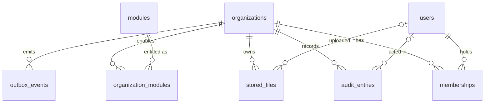

# Database schema (PR-003, isolation PR-005)

Alembic (`apps/api/migrations/`) is the only migration authority. SQLAlchemy 2 models live with
their owning core area (`apps/api/app/core/{tenancy,modules,audit,outbox,storage}/models.py`);
`app/core/db/registry.py` imports them all so `Base.metadata` is complete.

CRM models live under `app/modules/crm/`. Migration `0008` adds four tenant-owned tables
and `0009` adds reversible lead archiving;
see [CRM permissions, import format and recovery](../platform/crm.md).

**Status:** applied to local Docker Postgres and CI only. Not applied to the `onyx` Supabase
project (owner decision, PR-004: Supabase provides Auth only for now). Applying it there needs a
backup first and owner approval.

## Entities



| Table                  | Owner                    | Purpose                                              | Key rules                                                                                                                                |
| ---------------------- | ------------------------ | ---------------------------------------------------- | ---------------------------------------------------------------------------------------------------------------------------------------- |
| `organizations`        | tenant root              | A workspace (`/w/{slug}`)                            | `slug` unique; `status` active/suspended; `timezone` default `Europe/Malta`                                                              |
| `users`                | user                     | Staff profile                                        | `email` citext unique; `auth_subject` unique, links to Supabase Auth in PR-004 (no FK to `auth` schema)                                  |
| `memberships`          | tenant                   | Role of a user in one organisation                   | unique (`organization_id`, `user_id`); `role` owner/admin/member                                                                         |
| `modules`              | shared reference         | Module catalogue                                     | seeded by the migration: crm, catalogue, inbox, quotations, orders                                                                       |
| `organization_modules` | tenant                   | Entitlement + tenant config                          | PK (`organization_id`, `module_key`); `enabled` default false                                                                            |
| `audit_entries`        | tenant (null = platform) | Who did what                                         | **append-only** (trigger blocks UPDATE/DELETE); `request_id` correlates with logs (PR-006); `metadata` must not hold full message bodies |
| `outbox_events`        | tenant                   | Events written in the same transaction as the change | unique (`organization_id`, `idempotency_key`); partial index on pending `available_at`                                                   |
| `stored_files`         | tenant                   | Metadata of a file in object storage                 | `object_key` unique and CHECK-pinned to `tenants/<organization_id>/<id>`; `size_bytes >= 0`                                              |
| `platform_admins`      | platform                 | Onyx staff allowed into `/admin` (PR-007)            | PK `user_id`; RLS: read own row only; granted by the schema owner, never through the API                                                 |

Conventions:

- UUID primary keys from `gen_random_uuid()`; `timestamptz` columns, stored UTC.
- Enumerations are `VARCHAR` + `CHECK` (not native PG enums), so adding a value is a plain migration.
- Constraint names follow `app/core/db/base.py`'s naming convention, so migrations are deterministic.
- No money columns yet; when they arrive they use `NUMERIC` or integer minor units, never floats.
- Extensions: `citext`, `vector` (pgvector), created with `IF NOT EXISTS`.

## Tenant isolation (current state)

### Application role and identity policies (PR-004, migration `0002`)

- Requests run as `onyx_app` (`NOLOGIN NOBYPASSRLS`), entered per transaction with
  `SET LOCAL ROLE onyx_app`. The transaction also sets `app.current_auth_subject` (the verified
  JWT `sub`) with `set_config(..., true)`. Both reset at commit/rollback, so pooled connections
  never carry one user's context into another request (tested).
- Policies (all `TO onyx_app`; Supabase's `anon`/`authenticated` roles get none):

  | Table                                                  | Allowed for the caller                                                                                   |
  | ------------------------------------------------------ | -------------------------------------------------------------------------------------------------------- |
  | `users`                                                | read self and colleagues (shared organisation); insert/update self                                       |
  | `organizations`, `organization_modules`, `memberships` | read where the caller is a member                                                                        |
  | `organizations`                                        | update `name`/`timezone` as owner/admin of the bound tenant (PR-006, migration `0004`)                   |
  | `memberships`                                          | insert self only, backed by an invitation they accepted                                                  |
  | `invitations`                                          | read/create as owner/admin (owners alone invite owners); read/accept if addressed to the caller's email  |
  | `audit_entries`                                        | insert as a member of that organisation, as themselves; read as owner/admin of the bound tenant (PR-007) |
  | `outbox_events`                                        | insert in the bound tenant only (PR-005); no read                                                        |

- Helper functions `app_current_user_id()`, `app_membership_role(org)`, etc. are
  `SECURITY DEFINER` with a fixed `search_path`, so policies can consult memberships without
  recursion. Execute is granted to `onyx_app` only.
- In deployed environments `ONYX_API_DATABASE_URL` must be a login role that is a member of
  `onyx_app`, not a superuser and without `BYPASSRLS`. Locally the compose superuser connects
  and drops to `onyx_app` per transaction.

### Default deny

- Row-level security is enabled on every table except `modules` and `alembic_version`
  (`RLS_EXEMPT_TABLES`). Policies exist only for `onyx_app` and `onyx_worker`, so any other role
  except the table owner reads, inserts, updates and deletes nothing (tested with a throwaway
  non-owner role).
- A guard test fails if a new public table lacks RLS and is not explicitly exempted.
- The owner role (migrations, seeding) bypasses RLS because RLS is not `FORCE`d. It must never
  serve user requests or jobs.

### Tenant-bound business data (PR-005, migration `0003`)

Business data is scoped to **one bound tenant per transaction**, in addition to the identity
rules above.

- **Binding.** `app.current_organization_id` is set transaction-locally, read by
  `app_current_organization_id()`.
  - Requests: `get_workspace` resolves `/w/{slug}` through the caller's membership, then
    `bind_tenant()` sets the setting and re-checks membership. The tenant never comes from a
    URL id, body, header or model output; non-members get 404.
  - Workers: `worker_transaction(sessions, organization_id)` enters `onyx_worker`
    (`NOLOGIN NOBYPASSRLS`, no end user) and binds the job's tenant explicitly; an unknown
    organisation is rejected.
- **Policies** (`app/core/db/rls.py`, applied by `create_tenant_policies(table)`), on every
  command (`USING` and `WITH CHECK`):

  | Role          | Policy                  | A row is visible/writable when                                  |
  | ------------- | ----------------------- | --------------------------------------------------------------- |
  | `onyx_app`    | `<table>_tenant_app`    | `organization_id` = bound tenant **and** the caller is a member |
  | `onyx_worker` | `<table>_tenant_worker` | `organization_id` = bound tenant                                |

  Applied to `stored_files` and `outbox_events`. A forged setting therefore grants a user
  nothing without a membership; a malformed one raises an error (fails closed). The worker can
  also read its bound `organizations` row and `organization_modules`, and nothing in `users`,
  `memberships`, `invitations` or `audit_entries`.

- **Grants.** `onyx_app`: `stored_files` select/insert/delete and update of `filename` only (so
  `organization_id` cannot be changed); `outbox_events` insert only. `onyx_worker`: the same on
  `stored_files`; `outbox_events` select/insert and update of delivery columns.
- **Repositories.** `TenantRepository` (`app/core/db/repository.py`) adds an explicit
  `organization_id` filter on every read/delete and sets `organization_id` from the bound
  `TenantContext` on insert; passing it as input raises `TenantScopeError`.
- **Object storage.** `TenantFileService` (`app/core/storage/`) builds keys only as
  `tenants/<organization_id>/<file_id>` on the server, re-validates the key against the bound
  tenant before every read/delete, and serves a file only if its metadata row is visible. Another
  tenant's file id behaves like a missing one. Backends: in-memory (tests) and a local directory
  (development, confined to its root). A Supabase Storage backend (private bucket, server-side
  credentials) arrives with the first feature that stores real files.
- **New tenant tables** must call `create_tenant_policies()` in their migration. A guard test
  fails for any table with `organization_id` that lacks both policies, unless it is listed in
  `IDENTITY_SCOPED_TENANT_TABLES` (`memberships`, `invitations`, `organization_modules`,
  `audit_entries`, which keep their membership-based PR-004 rules).
- **Tests** (`tests/api/test_tenant_rls.py`, `test_tenant_context.py`,
  `test_workspace_tenant_binding.py`, `tests/test_storage_keys.py`): two tenants plus a user in
  both; cross-tenant reads, inserts, updates, deletes and file access; improper tenant
  selection (forged setting, non-member slug, ignored tenant headers/params); worker scoping;
  no context leak across transactions on one pooled connection.

Known limits:

- Both restricted roles are entered with `SET LOCAL ROLE` from the login role, so SQL that the
  application itself runs could `RESET ROLE`. The API never executes caller-supplied SQL (and
  LLMs never get SQL tools); keep it that way.
- The outbox relay that publishes events for all tenants needs its own cross-tenant role; it is
  designed with the Temporal worker (PR-020).
- Upload writes the object after the metadata row; a rolled-back transaction can leave an
  unreferenced object (never served). Reconciliation is a follow-up for the first real storage
  feature.

### Module entitlements (PR-008, migration `0006`)

- `app_module_enabled(org, key)` (SECURITY DEFINER, `onyx_app` + `onyx_worker`): used by
  module-owned tables' policies via `create_tenant_policies(table, module=…)`.
- `app_admin_set_module(slug, key, enabled, request_id)` (SECURITY DEFINER, `onyx_app`):
  raises `42501` unless the caller is a platform admin; upserts `organization_modules` and
  writes the tenant audit entry in the same transaction. Neither app role can write
  `organization_modules` directly.

### AI budgets and usage (PR-013, migration `0013`)

- `ai_budgets` (PK `organization_id`) and `ai_usage_events` carry the standard tenant policies,
  not gated by a module. `onyx_app` may only read them.
- The gateway writes as `onyx_worker` bound to the tenant: insert a `reserved` event, finalise
  it once, set `ai_budgets.alerted_period`. A trigger rejects any change to a finalised event
  and every DELETE, even by the schema owner. Cost is integer micro-USD.
- `app_admin_ai_budget(slug)` / `app_admin_set_ai_budget(slug, limit, alert, request_id)`
  (SECURITY DEFINER, `onyx_app`): platform admins only (`42501` otherwise); setting writes an
  `ai.budget.updated` audit entry in the same transaction. See `docs/platform/ai-gateway.md`.

### Deployed role setup (owner action, before the first deployed database)

```sql
-- As the schema owner, after `alembic upgrade head`:
CREATE ROLE onyx_api_login LOGIN PASSWORD '<secret>' NOSUPERUSER NOBYPASSRLS NOINHERIT;
GRANT onyx_app TO onyx_api_login;           -- API (ONYX_API_DATABASE_URL)
CREATE ROLE onyx_worker_login LOGIN PASSWORD '<secret>' NOSUPERUSER NOBYPASSRLS NOINHERIT;
GRANT onyx_worker TO onyx_worker_login;     -- Temporal worker (PR-020)
```

Never grant both roles to one login.

## Configuration

| Variable                          | Used by               | Notes                                                           |
| --------------------------------- | --------------------- | --------------------------------------------------------------- |
| `ONYX_API_DATABASE_URL`           | application (PR-004+) | `postgresql+psycopg://…`; secret in deployed environments       |
| `ONYX_API_MIGRATION_DATABASE_URL` | Alembic, seed         | schema-owner role; falls back to the URL above **locally only** |
| `ONYX_API_TEST_DATABASE_URL`      | pytest                | server for throwaway test databases (default: local compose)    |
| `ONYX_API_REQUIRE_DB`             | pytest                | `1` fails DB tests when Postgres is unreachable (set in CI)     |

## Seed fixtures

`make db-seed` (`app/core/db/seed.py`) inserts fictitious data with deterministic ids
(`seed_id(name)`), and re-running it changes nothing. It refuses to run in preview/production.

| Organisation            | Slug                    | Modules                           | Members                                                  |
| ----------------------- | ----------------------- | --------------------------------- | -------------------------------------------------------- |
| Lumen Lighting (test)   | `lumen-lighting-test`   | crm, catalogue, inbox, quotations | Olivia (owner), Adam (admin), Mia (member), Sam (member) |
| Harbour Catering (test) | `harbour-catering-test` | crm, inbox                        | Hugo (owner), Hana (admin), Max (member), Sam (admin)    |

Seeded users get fake auth subjects (`seed_auth_subject(email)`) that only tests can sign
tokens for. To use a seeded workspace with your real login locally, sign in once and run
`make db-grant email=you@example.com slug=lumen-lighting-test role=owner`.

Pat Platform (`pat.platform@onyx.example.test`) is a platform admin with no memberships (PR-007).

Sam Consultant belongs to both organisations with different roles, for workspace-selection and
cross-tenant tests. All emails use the reserved `.test` domain.

## Migrations runbook

```bash
make up                                   # local Postgres
make db-migrate                           # upgrade to head
make db-revision m="add customers table"  # autogenerate, then review and hand-edit
make db-downgrade                         # revert one step (local/test only)
make db-reset                             # empty → head → seed (local/test only)
```

Every migration must:

1. upgrade from empty and downgrade back to empty (`tests/db/test_migrations.py`);
2. leave models and schema in sync (`alembic check` runs in the tests);
3. enable RLS on any new tenant- or user-owned table;
4. document data-destroying steps in the downgrade.

### Rollback and recovery

- **Local/test:** `alembic downgrade` (via the Make targets). `0001`'s downgrade drops every table
  and its data; it keeps the extensions.
- **Deployed databases:** never downgrade a database holding data. Take a backup before every
  migration; recover with a forward-fix migration, or restore the backup if the data is damaged.
  `scripts/require-local-env.sh` blocks `make db-downgrade` / `make db-reset` outside
  `local`/`test`.
