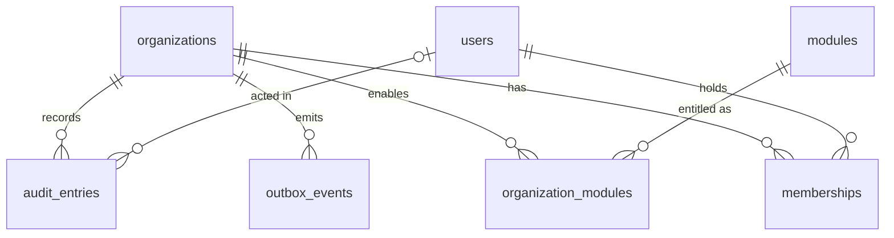

# Database schema (PR-003)

Alembic (`apps/api/migrations/`) is the only migration authority. SQLAlchemy 2 models live with
their owning core area (`apps/api/app/core/{tenancy,modules,audit,outbox}/models.py`);
`app/core/db/registry.py` imports them all so `Base.metadata` is complete.

**Status:** applied to local Docker Postgres and CI only. Not applied to the `onyx` Supabase
project (owner decision, PR-004: Supabase provides Auth only for now). Applying it there needs a
backup first and owner approval.

## Entities



| Table                  | Owner                    | Purpose                                              | Key rules                                                                                               |
| ---------------------- | ------------------------ | ---------------------------------------------------- | ------------------------------------------------------------------------------------------------------- |
| `organizations`        | tenant root              | A workspace (`/w/{slug}`)                            | `slug` unique; `status` active/suspended; `timezone` default `Europe/Malta`                             |
| `users`                | user                     | Staff profile                                        | `email` citext unique; `auth_subject` unique, links to Supabase Auth in PR-004 (no FK to `auth` schema) |
| `memberships`          | tenant                   | Role of a user in one organisation                   | unique (`organization_id`, `user_id`); `role` owner/admin/member                                        |
| `modules`              | shared reference         | Module catalogue                                     | seeded by the migration: crm, catalogue, inbox, quotations, orders                                      |
| `organization_modules` | tenant                   | Entitlement + tenant config                          | PK (`organization_id`, `module_key`); `enabled` default false                                           |
| `audit_entries`        | tenant (null = platform) | Who did what                                         | **append-only** (trigger blocks UPDATE/DELETE); `metadata` must not hold full message bodies            |
| `outbox_events`        | tenant                   | Events written in the same transaction as the change | unique (`organization_id`, `idempotency_key`); partial index on pending `available_at`                  |

Conventions:

- UUID primary keys from `gen_random_uuid()`; `timestamptz` columns, stored UTC.
- Enumerations are `VARCHAR` + `CHECK` (not native PG enums), so adding a value is a plain migration.
- Constraint names follow `app/core/db/base.py`'s naming convention, so migrations are deterministic.
- No money columns yet; when they arrive they use `NUMERIC` or integer minor units, never floats.
- Extensions: `citext`, `vector` (pgvector), created with `IF NOT EXISTS`.

## Tenant isolation (current state)

### Application role and identity policies (PR-004, migration `0002`)

- Requests run as `onyx_app` (`NOLOGIN NOBYPASSRLS`), entered per transaction with
  `SET LOCAL ROLE onyx_app`. The transaction also sets `app.current_auth_subject` (the verified
  JWT `sub`) with `set_config(..., true)`. Both reset at commit/rollback, so pooled connections
  never carry one user's context into another request (tested).
- Policies (all `TO onyx_app`; Supabase's `anon`/`authenticated` roles get none):

  | Table                                                  | Allowed for the caller                                                                                  |
  | ------------------------------------------------------ | ------------------------------------------------------------------------------------------------------- |
  | `users`                                                | read self and colleagues (shared organisation); insert/update self                                      |
  | `organizations`, `organization_modules`, `memberships` | read where the caller is a member                                                                       |
  | `memberships`                                          | insert self only, backed by an invitation they accepted                                                 |
  | `invitations`                                          | read/create as owner/admin (owners alone invite owners); read/accept if addressed to the caller's email |
  | `audit_entries`                                        | insert as a member of that organisation, as themselves; no read                                         |
  | `outbox_events`                                        | nothing yet                                                                                             |

- Helper functions `app_current_user_id()`, `app_membership_role(org)`, etc. are
  `SECURITY DEFINER` with a fixed `search_path`, so policies can consult memberships without
  recursion. Execute is granted to `onyx_app` only.
- In deployed environments `ONYX_API_DATABASE_URL` must be a login role that is a member of
  `onyx_app`, not a superuser and without `BYPASSRLS`. Locally the compose superuser connects
  and drops to `onyx_app` per transaction.

### Default deny

- Row-level security is **enabled with no policies** on every table except `modules` and
  `alembic_version` (`RLS_EXEMPT_TABLES`). Any role other than the table owner therefore reads,
  inserts, updates and deletes nothing. Tests prove this with a throwaway non-owner role.
- A guard test fails if a new public table lacks RLS and is not explicitly exempted.
- The owner role (migrations, seeding) bypasses RLS because RLS is not `FORCE`d. It must never
  serve user requests.
- **PR-005** adds per-tenant policies for business data and tenant-scoped repositories.

## Configuration

| Variable                          | Used by               | Notes                                                           |
| --------------------------------- | --------------------- | --------------------------------------------------------------- |
| `ONYX_API_DATABASE_URL`           | application (PR-004+) | `postgresql+psycopg://…`; secret in deployed environments       |
| `ONYX_API_MIGRATION_DATABASE_URL` | Alembic, seed         | schema-owner role; falls back to the URL above **locally only** |
| `ONYX_API_TEST_DATABASE_URL`      | pytest                | server for throwaway test databases (default: local compose)    |
| `ONYX_API_REQUIRE_DB`             | pytest                | `1` fails DB tests when Postgres is unreachable (set in CI)     |

## Seed fixtures

`make db-seed` (`app/core/db/seed.py`) inserts fictitious data with deterministic ids
(`seed_id(name)`), and re-running it changes nothing. It refuses to run in preview/production.

| Organisation            | Slug                    | Modules                           | Members                                                  |
| ----------------------- | ----------------------- | --------------------------------- | -------------------------------------------------------- |
| Lumen Lighting (test)   | `lumen-lighting-test`   | crm, catalogue, inbox, quotations | Olivia (owner), Adam (admin), Mia (member), Sam (member) |
| Harbour Catering (test) | `harbour-catering-test` | crm, inbox                        | Hugo (owner), Hana (admin), Max (member), Sam (admin)    |

Seeded users get fake auth subjects (`seed_auth_subject(email)`) that only tests can sign
tokens for. To use a seeded workspace with your real login locally, sign in once and run
`make db-grant email=you@example.com slug=lumen-lighting-test role=owner`.

Sam Consultant belongs to both organisations with different roles, for workspace-selection and
cross-tenant tests. All emails use the reserved `.test` domain.

## Migrations runbook

```bash
make up                                   # local Postgres
make db-migrate                           # upgrade to head
make db-revision m="add customers table"  # autogenerate, then review and hand-edit
make db-downgrade                         # revert one step (local/test only)
make db-reset                             # empty → head → seed (local/test only)
```

Every migration must:

1. upgrade from empty and downgrade back to empty (`tests/db/test_migrations.py`);
2. leave models and schema in sync (`alembic check` runs in the tests);
3. enable RLS on any new tenant- or user-owned table;
4. document data-destroying steps in the downgrade.

### Rollback and recovery

- **Local/test:** `alembic downgrade` (via the Make targets). `0001`'s downgrade drops every table
  and its data; it keeps the extensions.
- **Deployed databases:** never downgrade a database holding data. Take a backup before every
  migration; recover with a forward-fix migration, or restore the backup if the data is damaged.
  `scripts/require-local-env.sh` blocks `make db-downgrade` / `make db-reset` outside
  `local`/`test`.
